# Whitsunday in Motion

Field journal for a motion-activated interactive display at Whitsunday Coast Airport. Research, dead ends, the maths that took four goes, and the build that came out the other side.

*Matt Bissell · BCI304 · UniSC · August – October 2026*

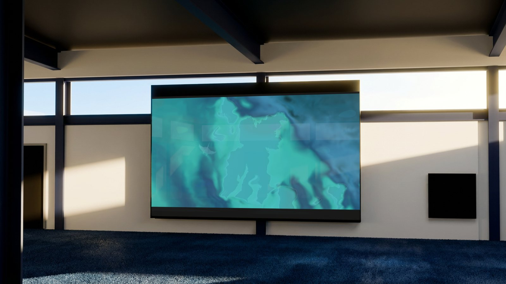

*The display in situ. Greyboxed terminal with the map running, lit as described further down.*

This is the working journal for my part of **Whitsunday in Motion**, a team project developing interactive displays for Whitsunday Coast Airport with Whitsunday Regional Council as the partner. The team had enough people across 3D modelling and environment work, so I took the interaction and technical strand: sensing, and building a functional TouchDesigner prototype using the Kinect. I also delivered a MediaPipe version because it is easier to test — though it should be noted that MediaPipe cannot differentiate between multiple skeletons.

The outcome I took to the presentation is a **sculpture finder**. A bathymetric map of the waters around Hook Island, essentially where the sculpture lane is, sits under a layer of water. A person standing in front of the display parts the water with their hands, and holding over one of the Ngaro underwater sculptures or a reef restoration site reveals it and names it.

For this interaction the map is not a 1:1 recreation of where the sculptures are. Positions live in a TouchDesigner table and can be moved per sculpture and location.

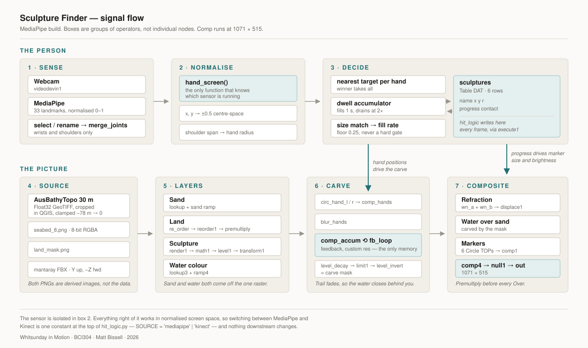

*How it works end to end. Two tracks that meet at the carve. Everything right of box 2 works in normalised screen space, which is why swapping the sensor is one constant.*

## Reading and context

Fin set the Week 5–6 brief: research the Whitsundays' history, places and ecosystems, look at interactive installation work, come back with a broad idea. Named starting points were TouchDesigner, **Torin Blankensmith**, **teamLab** and **Universal Everything**, with **bileam tschepe** and **Josef Pelz** on the technique side. **INDE**, who build AR into airport baggage halls, was the closest thing to a direct commercial precedent for the brief we had.

Most of my reference gathering was practitioner work rather than literature. Universal Everything and teamLab at the ambient, body-driven end, and directed instruction-led pieces at the other, to see what a prompt-based experience costs you in atmosphere.

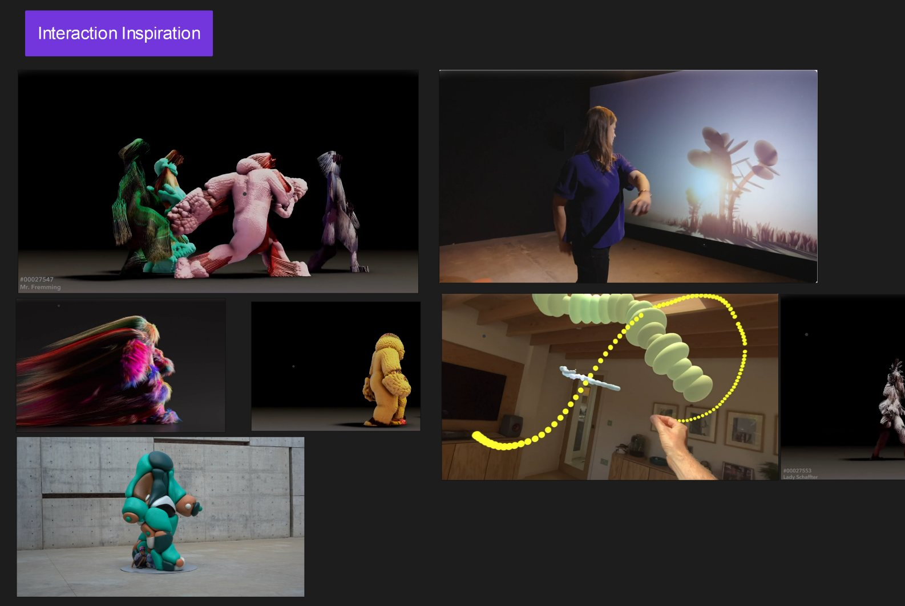

*Reference board. Ambient and body-driven at one end, directed and instruction-led at the other.*

### Interaction types

When looking at interactions and in the scheduled team meetings it made sense to document a category system for interaction. After some research on UX and interaction:

- **Hidden or hard to notice.** Observing presence, using presence to drive some effect, but with something happening even without anyone there.
- **A spot on the ground** that activates the sensor. "Stand here", outlines of feet.
- **A prompt on the screen itself.**
- **Gamified.** Controlling a character, text or quiz based.

The sculpture finder has a resting state that runs whether or not anyone is there, which can act as a nice ambient. Not putting "stand here" on the floor and not putting a prompt on the screen are decisions against categories two and three, and the reasoning is in the inclusive design entry further down.

### What interactivity actually means here

The reading that stuck was on interactivity as a *spectrum* rather than a property, running from passive consumption through to genuine co-creation. People working together might find a sculpture first, or race others to find the rest. But it is important that your control over the interaction is apparent and meaningful, which steers the direction toward artistic, hands-on and informational if so desired — hovering on a sculpture could activate an information screen.

Importantly the question should not just be "does it respond", but "how much of what appears on screen did the person actually author". The sculpture finder is honestly somewhere in the middle: you choose what to uncover and the order you uncover it in, and that is the whole of your authorship.

### Transit spaces specifically

Research on public displays describes *display blindness*: screens in transit spaces get filtered out as advertising before anyone reads them, and the Audience Funnel model describes the stages a passer-by moves through before they are actually interacting rather than just walking past. Everything in the build below is downstream of that. If the display waits to be approached and touched, it loses most people at the first stage.

## Who it's for

The team circled around a persona early, so it belongs up here rather than buried in a weekly entry.

It was in our own stakeholder questions from the start. The note we drafted for Fin to take to the Council opens: *"Treating this as a means of advertising the Whitsundays to people visiting for events (a la Olympics), what are some local attractions the stakeholders want us to demonstrate here?"* So the event framing is not something I have reverse engineered onto the project. It is where the team started.

The deployment window is **2032**. Sailing for the Brisbane Olympic and Paralympic Games was relocated to the Whitsundays in the Queensland Government's 100-Day Review in March 2025, with racing on the Whitsunday Passage and Airlie Beach as the base. That gives the project a real date and a real crowd rather than a hypothetical one.

The persona that came out of it is an international visitor arriving for a sailing event. Mid to upper income, disposable spending, in the Whitsundays for the first time and probably the only time. They are not coming for the reef. They are coming for a regatta, and the reef is what happens to be there.

That last sentence is the design problem. Everything below about display blindness, and about presence rather than reaching, is downstream of designing for someone whose attention is already committed to something else.

Worth being accurate about how settled this was. The same notes record the demographic question as explicitly open — *"Wide demographic. Could we target specifics with different displays?"* — which was never closed, but was a constant thought through the project.

- **Arriving or departing?** Someone arriving for an event has a fixed schedule and may never reach the sculpture trail. Someone departing has already seen the place and is deciding what they think of it. The first makes the display a conversion tool, the second a legacy one. They are not the same design, and I have been building as though the question does not exist.
- **The persona contains a contradiction.** A high-disposable-income visitor audience is both the group most able to visit and fund reef restoration, and the group whose tourism puts pressure on the reef to begin with. The display surfaces recovery work to exactly the people who are both the money and the threat. I do not have a position on that yet.
- **Does the precedent research still apply?** Display blindness and the Audience Funnel are mostly studied on bored commuters in ordinary transit. An Olympic-period terminal is a surge environment: dense, excited, time-pressured, multilingual. teamLab is a destination people buy tickets for and INDE's work is aimed at people standing still at a baggage carousel with nothing else to do. Neither is a crowd moving through at pace. I am not sure how much transfers, and the places it breaks are probably more interesting than the places it holds.

### Six years is a long time

Crucial pieces of technology can spark huge changes in this space. However I would argue simple, well thought out interactions are still timeless.

---

**Week 5 — the project plan**

## Roles, and what we did not have

Task 1 was the project plan and it allocated sections by name. Mine was **Risk Management**. On the working roles I was down for **Research** alongside Alex Luc, while also researching the Kinect — what is possible with it, what it has been used for in interactive work, and how real-time interaction might actually be deployed.

Past works I do fall more on the creative or artistic side, but I am fascinated by technical art and I enjoy working with TouchDesigner and Blender, where you can work with an interesting blend of art and science. For this project we had modellers, so I gravitated toward the TouchDesigner interaction.

### Previous group's work

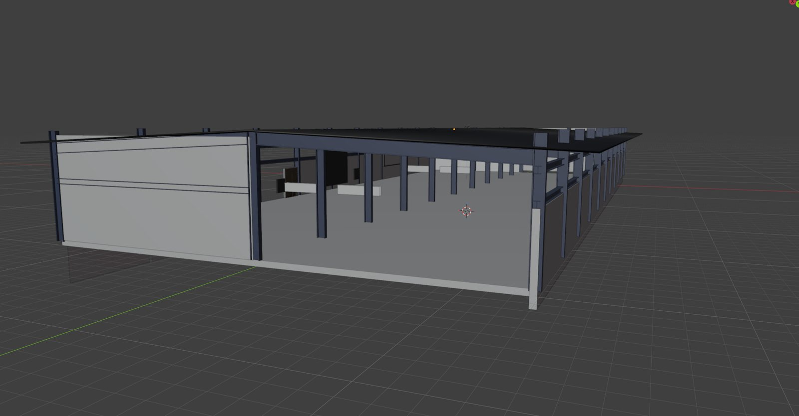

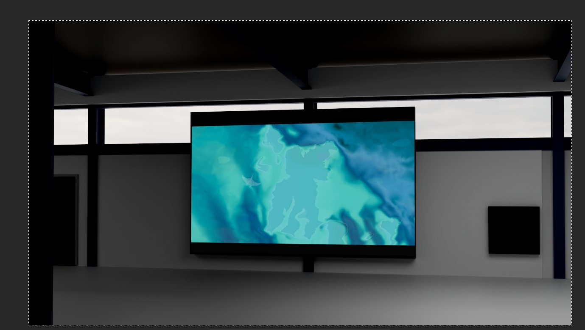

*What we inherited. Overlapping geometry and non-uniform scale on the meshes, which is enough to make Unreal's lighting behave oddly.*

We had been planning around inheriting 3D models, textures and technical documentation. What came back was "not really, more 2D mockup anim". Matthew Oliver's modelling task was written as "improving on the 3D model built by Graham", and there was no model to improve.

Stakeholder access ran entirely through Fin. The plan has a section of questions for stakeholders that we had no way to ask directly, and the communication chain in the notes reads, verbatim, "ask Dylan to annoy Fin to annoy the Stakeholders." Funny at the time. It is also the structural reason there is no direct community engagement anywhere in this project.

We also never received the airport specifications — screen size, hardware, mounting, orientation. Every resolution and aspect decision in this journal is made against an assumption rather than a spec.

### The timeline we set

| Week | Planned |
|---|---|
| 5 | Task 1 submission |
| 5–7 | Research and brainstorming, collated into shared docs |
| 6 | Identify 1–3 possible installations, select the primary one |
| 6–8 | Co-create interactive prototype. 3D model development |
| 8 | 3D model ready for mock-ups |
| 10 | Operational prototype and pitch deck draft |
| 11 | Task 2 or 3 draft |
| 12 | Task 2 and 3 submission |

---

**12.08.2026 — Week 5**

## Research, moodboard, and a grid to argue with

Brief for the week was blue-sky: research the Whitsundays' history, places and ecosystems, look at interactive installation work, and come back with a direction. I collected reference images from around the Whitsundays and started a shared moodboard.

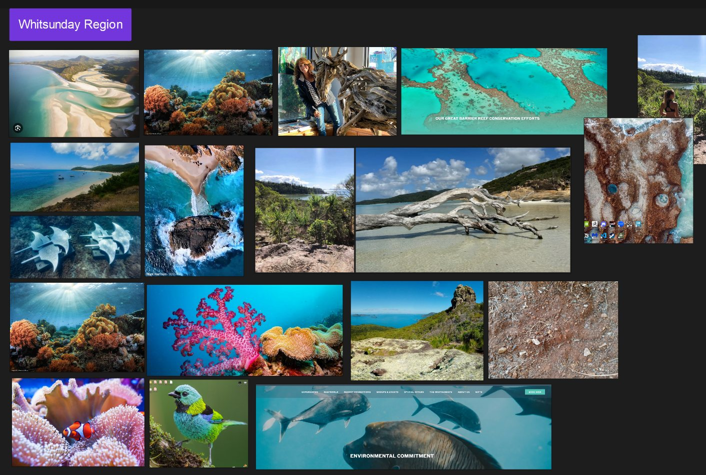

*Whitsundays reference board. Aerials, coral, coastline, marine life.*

Rather than just dumping references in, I set up a simple 2×2 grid and asked everyone to place what they found on it. Two axes:

- **Informational** ↔ **Aesthetic**
- **Directed** ↔ **Ambient**

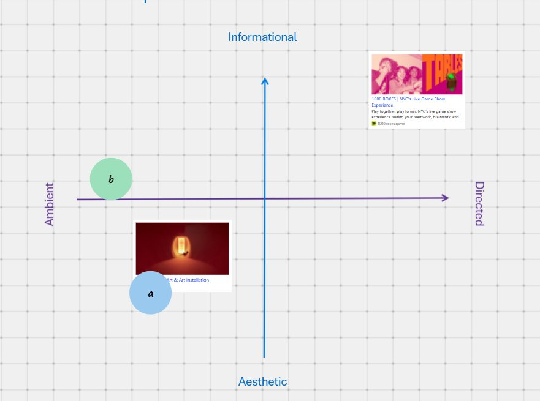

*The grid. Informational against Aesthetic, Ambient against Directed.*

This was useful and something I will use going forward — a 2×2 grid to sort interactions. My examples landed in the aesthetic and ambient corner. Nearly everything that would be defensible to a council landed in the informational corner, which is a good consideration. Having that visible on a grid meant the difference between my interests and the client's interests was something the team could point at and discuss, rather than something that surfaced later as a disagreement about a specific design.

### Sensing

The Kinect is a genuinely good piece of hardware and there is already one in the Whitsundays. The risk is Kinect Studio being legacy software on current Windows, though Kinect Studio with recorded footage worked a treat here. MediaPipe also produces similar enough data — skeletal tracking, landmarks, straight into TouchDesigner — so I treated it as the stand-in from the start. That decision turned out to matter a lot more than I thought it would.

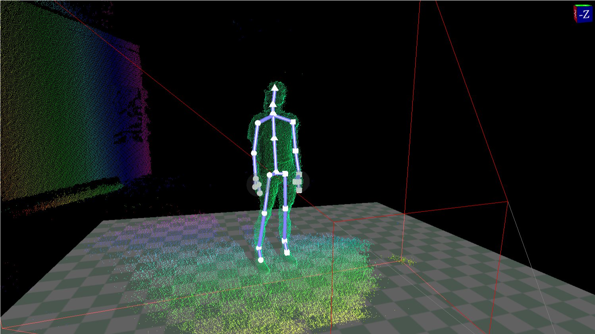

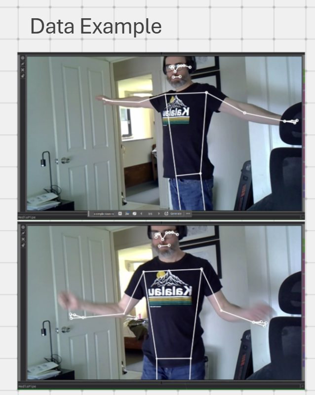

*Kinect depth point cloud with the skeleton solved on top. Same kind of data out of MediaPipe from a webcam.*

---

**16.08.2026**

## Three concepts

### Proximity sea anemone

Anemone tendrils, scattered geometry or splines, swaying in simulated current. People are detected and represented in the scene as an invisible sphere, with the sphere's influence driven by distance from the screen. You move through the anemone the way a clownfish does, seeing a part of the Whitsundays from a vantage point you would not otherwise get.

I had built something close to this before in Blender with geometry nodes, so it was achievable. A REST API could drive the current from real tidal data, and Ngaro sculptures could sit in the scene.

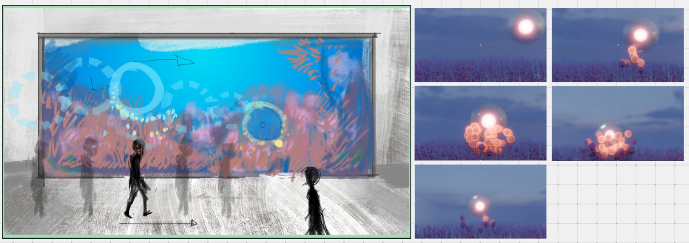

*Anemone concept in the terminal, with the earlier Blender geometry-nodes tests it came from.*

### Human flora and fauna

Inspired by Universal Everything's *Digital Twin*. Take skeletal data and build an amorphous mix of Whitsunday flora and fauna onto it: feathers, leaves, coastal driftwood, schools of fish, coral. Terminals are busy spaces, and people walking through become moving billboards for the ecology of the region.

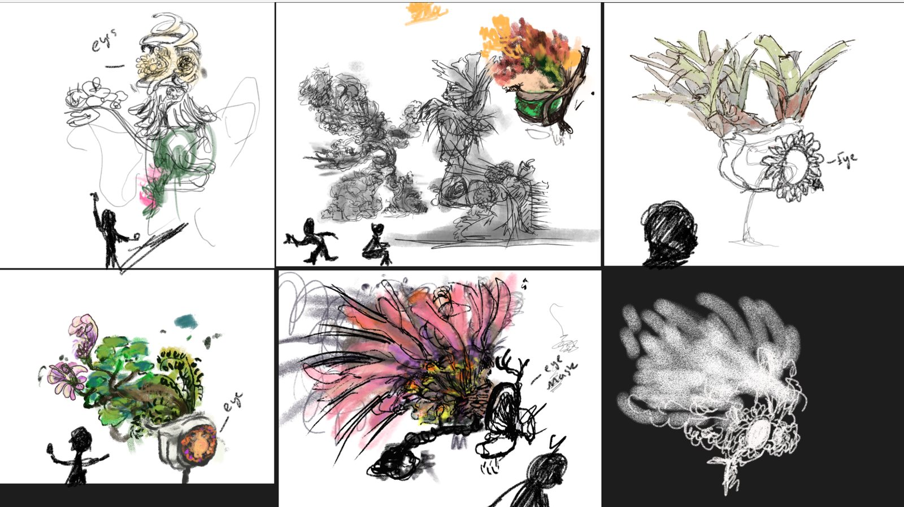

*Sketch studies. Whitsunday ecology mapped onto a moving body.*

### I heart reef

Aerial photography of the region already looks like dancing forms. This one uses a person's silhouette to morph the reef shapes with their body and motion.

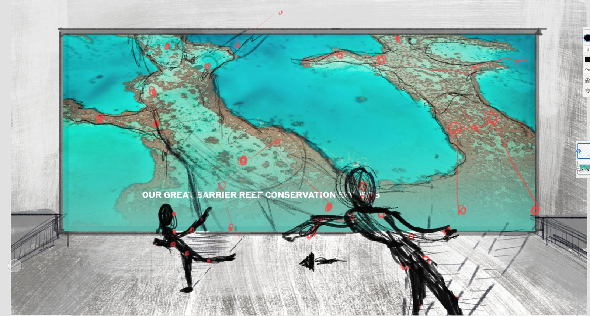

*Silhouettes morphing reef shapes, sketched into the terminal.*

The team responded most to this one, so it went forward. What was worth testing was less the effect than whether the interaction was actually engaging.

---

**01.10.2026**

## Reef mapping to silhouette — proof of concept

Source data is **AusBathyTopo (Great Barrier Reef)**, a depth model from Geoscience Australia. The first version of the concept was a test of whether a person could be mapped to bathymetry as a silhouette, letting the same contour geometry read as both terrain and human form. It was promising but not enough.

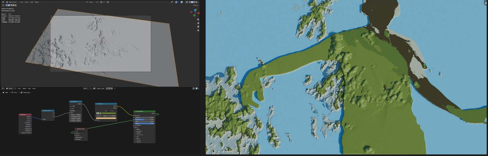

*Displacement test in Blender. Node setup left, result right.*

The problem was not that the map could not be made to react. The problem was that the response was too generic. The human body was being pushed into the terrain as a literal silhouette, but without enough relief or enough local variance to feel like a physical interaction.

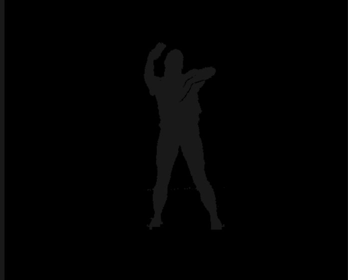

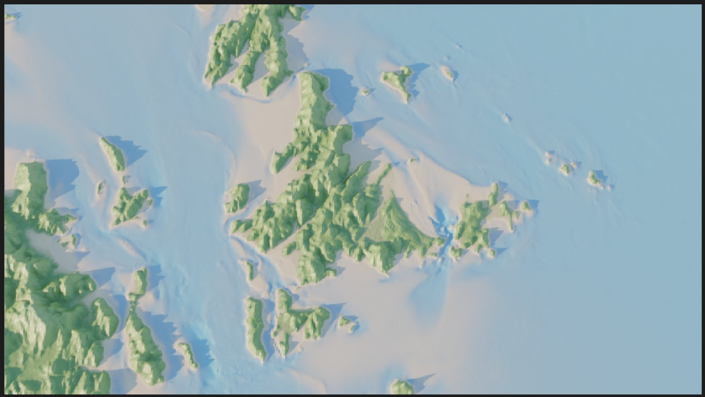

*The silhouette source, and shaded relief off the bathymetry. All the visual interest is in the shallow sand, which decided the ramp later.*

A softer gradient and a better understanding of the data resolved that. The key conceptual shift was from "pushing a silhouette into the terrain" to "accumulating motion as a brush over the seabed."

This led to the water-parting mechanic and eventually the dwell-based reveal system.

---

**06.10.2026**

## Understanding the data before calibrating against it

Understanding bathymetry was a deep dive into not only the data itself but right back to what a Vec4 is, and how RGB works versus a single Float32 band. The idea that metre values are stored on a *single band* as Float32 was genuinely foreign to me, and I could not calibrate anything against numbers I did not understand.

A pixel is a container. If it is a `Vec4` it holds four numbers, and the numbers have no inherent meaning. What they become depends entirely on what reads them.

> The same three numbers `[0.2, 0.4, 0.1]` are a mossy green if you plug them into light bulbs, and a position 20% right, 40% up and 10% forward if you plug them into a 3D room. The computer has no opinion about which.

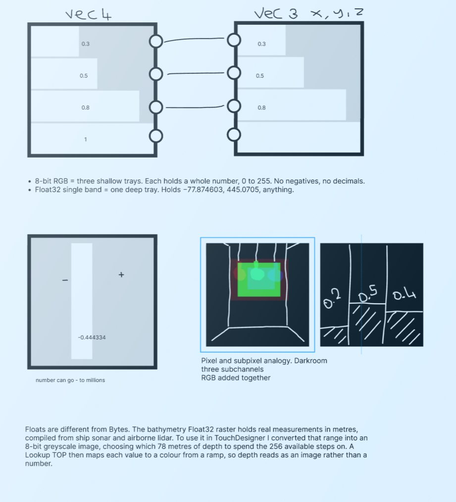

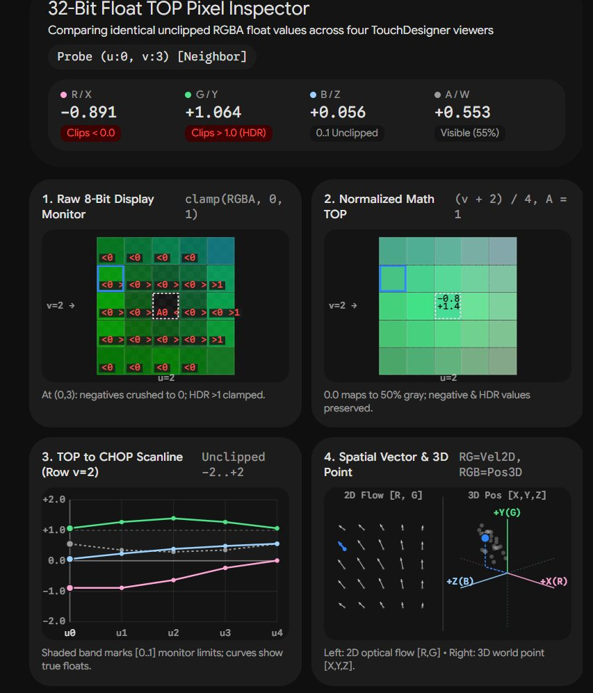

*Working it out on paper. Right: the same values through four different TouchDesigner viewers.*

Most height maps use RGB to carry the same number three times, because all anyone wants out of them is a brightness. The bathymetry file is doing something different: one band, carrying an actual measurement in metres, as a float.

### Why a single band can hold decimals and negatives

A Byte channel is eight bits, all magnitude. 0 to 255. No sign, no decimal point. A Float32 is thirty-two bits divided up as **1 sign bit, 8 exponent bits and 23 mantissa bits**, which gives roughly seven significant digits and a sign. That is why the raster can say −77.875 metres and a Byte image cannot.

It also explains why QGIS showing me a greyscale picture is a *rendering* and not the file. A monitor can only emit 0–255 per channel, so QGIS maps the raster's min and max through a ramp to display it. The picture on screen and the data in the file are two different things.

### The actual numbers in my crop

| Property | Value |
|---|---|
| Size | 1071 × 486 cells = **520,506 depth soundings** |
| Format | Single band, Float32, 2.08 MB |
| Range | −77.875 m to 445.070 m, mean −17.971 |
| Valid cells | 100% (NoData −9999, none present) |
| CRS | WGS84 EPSG:4326, pixel size 0.0003° |

TouchDesigner needs it as an image, so it gets converted to 0–255. **78 metres across 255 levels is 0.306 m per level**, which is finer than the original survey's own accuracy, so nothing real is lost in the conversion. Cropping tightly before export matters: the 255 levels get spent entirely on the range you keep. A crop that includes 445 m of mountain spends most of its levels on land nobody is looking at.

---

**06.10.2026**

## What the Kinect is actually doing

I had assumed the Kinect sprays the room with infrared, times how long each photon takes to come back, builds a point cloud, and derives a skeleton from that geometry. About half right, and the half I had wrong turned out to matter for the design.

The v2 is a **time-of-flight** sensor. It floods the scene with modulated infrared and measures the phase shift of the light coming back, which gives a distance per pixel across a 512×424 sensor. That is roughly 220,000 depth samples, thirty times a second.

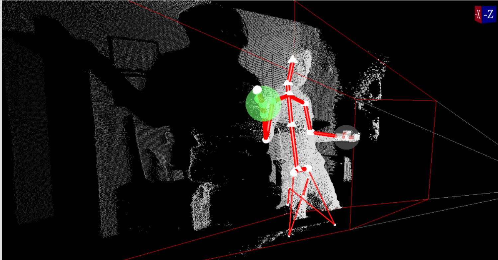

*What the sensor gives you and what gets inferred from it. The point cloud is measured. The skeleton on top of it is not.*

The part I had wrong is the skeleton. It is **not** derived geometrically from the point cloud. It is machine learning: every pixel of the depth image is classified as a body part by a model trained on roughly a million synthetic depth images of people, and the 25 joint positions are inferred from those labelled regions, at 30 fps.

> **Why this changed a design decision.** A geometric solution either works or it does not. A learned one works best on poses that resemble its training data. That is why the skeleton flickers in unusual postures — and it means anyone whose posture sits outside that training distribution, including seated and wheelchair users, gets worse tracking for reasons that have nothing to do with whether the sensor can see them.

> This is the reasoning behind making presence rather than reaching the primary trigger, further down.

---

**07.10.2026**

## Getting circles onto wrists, which was four problems wearing a trenchcoat

Selecting the joints is easy. A Select CHOP pulls `hand_l`, `hand_r` and spine translation out of the Kinect CHOP's 76 channels, and a rename gives them workable names.

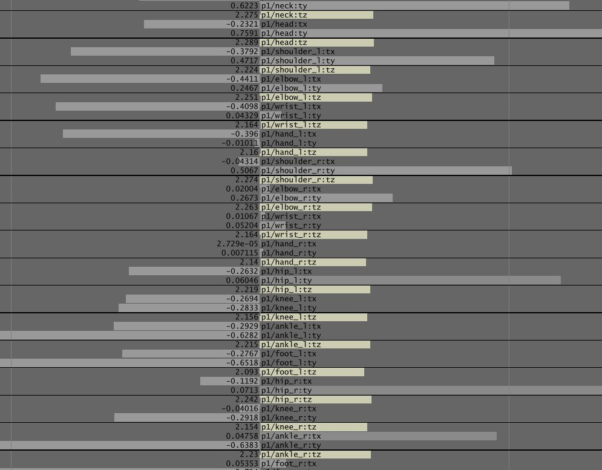

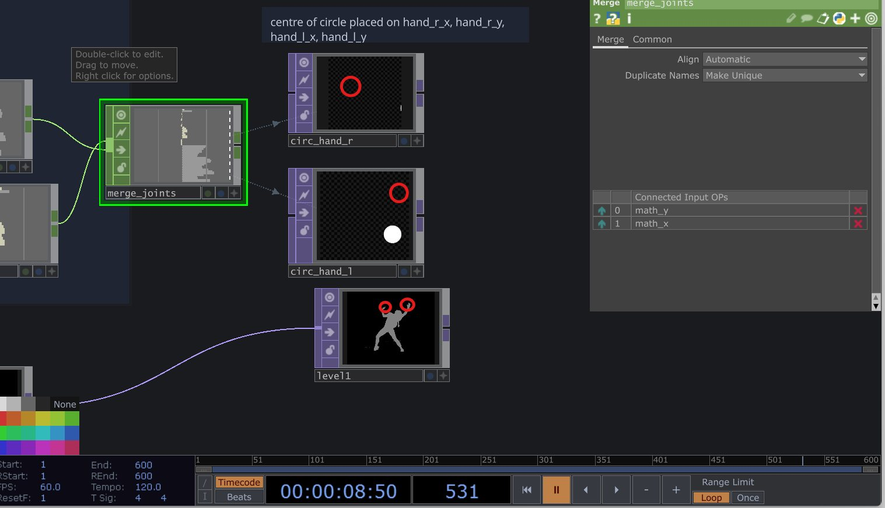

*Raw channel values, and the chain: select, rename, split per axis, merge, into the Circle TOPs.*

Drawing a circle at those values is where it fell apart. The circles tracked, roughly, but sat nowhere near the wrists and got worse as I moved. I spent a while assuming it was one bug. It was four, stacked.

### 1. Units

Kinect reports joints in **metres, in 3D, measured from the sensor**. A Circle TOP wants a **fraction of the frame**. Those are not the same kind of number and no amount of scaling fixes it if the conversion is not explicit.

The conversion is the perspective divide. At distance *z*, half the frame width in metres is `tan(FOV/2) × z`. Kinect v2's horizontal field of view is 70.6°, so `tan(35.3°) = 0.709`, and half-width is `0.709z`. Divide the joint's x by that and you get a fraction of the frame that does not change when you walk backwards. Vertical FOV is 60°, so the vertical constant is `tan(30°) = 0.577`.

### 2. Origin

The sensor and the screen do not share a coordinate system, and the origin is not in the same place. The same joint can read "in front of the camera" while the comp expects it to be "in the middle of the screen". Each hop is a shift of 0.5.

I proved which space the Circle TOP was in by setting Center X to a literal `0.5`. The circle sat half off the edge, so 0.5 is the *edge* and the space is ±0.5, not ±1.

### 3. Direction

A Kinect points in a different direction to the display's projected coordinate system. Axes may be flipped, mirrored or reversed. A hand moving right on the sensor is not necessarily moving right on screen.

Flipping one axis is also where the Math CHOP let me down: its range applies to every channel in the stream, so there is no way to negate x and leave y alone. The chain has to split into `select_x` and `select_y`, apply a Math CHOP to each, then merge back.

### 4. Scale per axis

Perspective differences and aspect ratio mean the x and y axes are not interchangeable. x is a fraction of *width*, y a fraction of *height*. On a comp that is not square those are different distances in pixels, so any distance test has to divide dy by the aspect ratio first. Otherwise the region being tested is an ellipse while the circle being drawn is a circle.

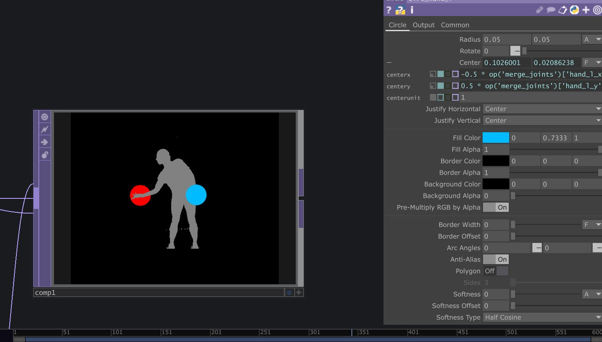

*Working. Red on the right wrist, cyan on the left, holding position as the figure moves toward and away from camera.*

The real lesson is that the problem was not "the coordinates are wrong". It was four separate coordinate-system mismatches that needed to be explained and fixed one by one.

A key guard in the code was the use of `max()` to stop `z` values from accidentally going near zero on dropped frames, which would otherwise blow up the divide and send the circle off screen.

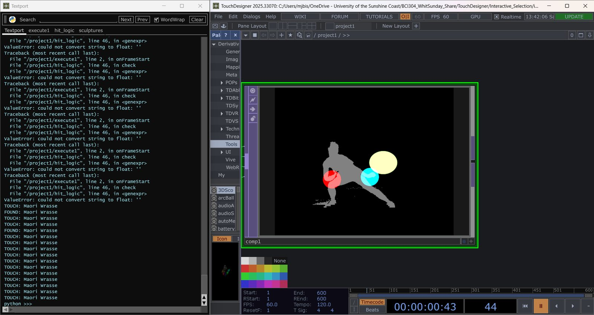

*The Textport became the fastest debugging tool in TouchDesigner. It was the only place raw values could be inspected quickly enough to separate logic problems from coordinate problems.*

---

**08.10.2026**

## What the interaction is actually about

The sculpture trail was on the research list from week five, and so was a line I did not pay enough attention to at the time: *"Research local Ngaro/Gia opinions of the sculptures."* The team identified the cultural question in the first fortnight. I will come back to what happened to it.

Looking up where the sculptures actually are, they are more clustered than I assumed: the **Ngaro Underwater Marine Sculpture Trail** sits mostly in and around Hook Island. *Migration of the Mantas* and *Manta Ray* at Manta Ray Bay, *Maori Wrasse* and *Anthozoa* at Blue Pearl Bay off Hayman Island, *Turtle Dream* at Langford Spit. *Bywa* is at Horseshoe Bay in Bowen, outside the crop.

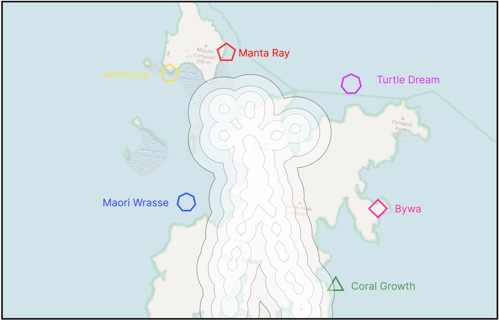

*The trail mapped. Zooming the prototype to this cluster spaces the finds out and leaves room for restoration sites alongside the artworks.*

Zooming the prototype map in on that cluster spaces the finds out properly, and it leaves room to include **Reef Ecologic's WRAP** coral restoration sites alongside the artworks — what is being planted and grown, not just what has been installed.

That shifts what the interaction is for. Reef health in the Whitsundays is an economic question as much as an environmental one, because the regional tourism economy is built on the reef being worth visiting. Surfacing restoration work next to the artworks ties the display to **SDG 14, Life Below Water**, rather than leaving it as a map of sculptures.

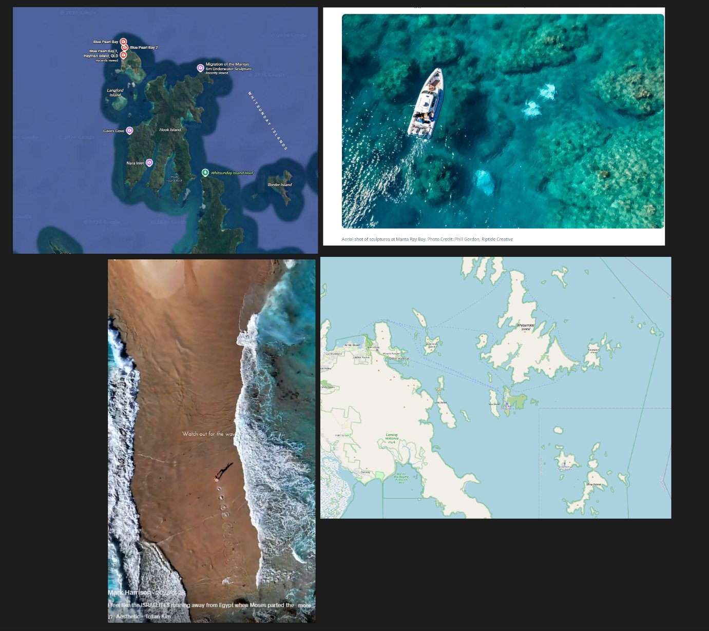

*Source material for the locations. Exact positions are published on tourism sites.*

A later extension worth noting: if the find is "the manta ray", the payoff could be real tagged manta ray data in the Whitsundays, the way a shark tracker works.

---

**08.10.2026**

## The Midas touch problem, and dwell as the answer

The obvious way to trigger a find is proximity: hand over sculpture, sculpture fires. The obvious way is wrong, and it has a name. The **Midas touch problem** is well documented in gaze and gesture interfaces — if looking at something selects it, you select everything you look at. A hand sweeping across the map would trigger every sculpture it crossed.

The standard answer is **dwell**, and that is what I have used. It is established HCI rather than something I invented, and it is worth saying so.

Each sculpture has an accumulator. While a hand overlaps it, the accumulator fills. When the hand leaves, it drains — **twice as fast as it fills**, so a hand passing through does not leave a half-charged target sitting there waiting to be nudged over the line. At one second to fill, running at 60 fps, that is `dt / DWELL` per frame.

### Making distance matter without making it a gate

The hand circle's radius is itself distance-dependent, because it goes through the same perspective divide. Stand at the right distance and the hand circle matches the target's radius. I wanted that match to *matter*, because it gives the interaction something to learn, but I did not want it to be a gate.

So the fill rate is:

```
rate = MIN_RATE + (1.0 - MIN_RATE) * match    # MIN_RATE = 0.25
```

Perfect distance fills in a second. Badly wrong distance fills in four. The floor never reaches zero, so nobody can do everything right and get no response at all with no explanation of why. And because the fill visibly speeds up as you find the sweet spot, the mechanic teaches itself without any instructions on screen.

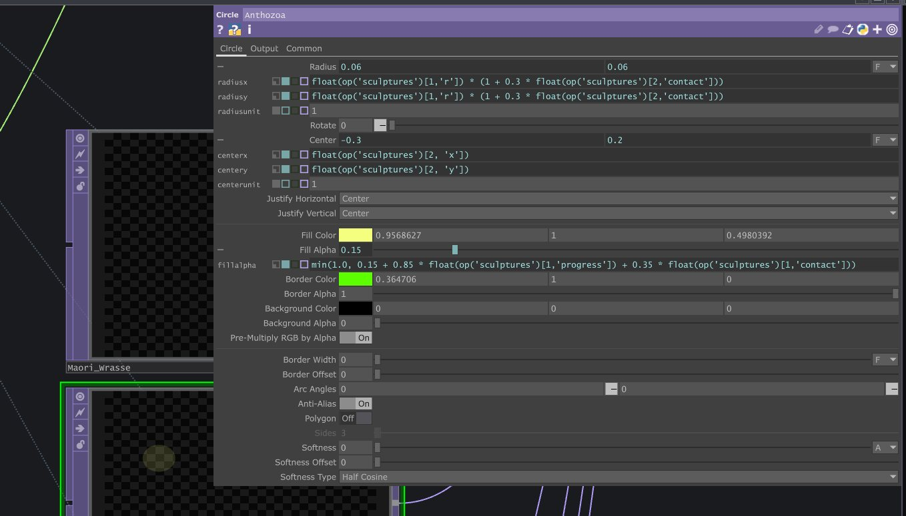

*Radius and Fill Alpha driven off the `progress` and `contact` columns, so the circle grows and brightens as the accumulator fills.*

---

**09.10.2026**

## Everything triggering at once

First symptom was every sculpture charging whenever a hand was anywhere near the cluster. My first guess was that `HAND_SIZE` at 0.15 was simply too large. Lowering it did not help, which was the useful information — a radius that is too big produces *more* hits, but it does not produce hits on targets the hand is nowhere near.

Two separate causes.

**Visual.** The Circle TOPs had their Center expressions updated to their own table row, but Radius and Fill Alpha were still pointing at row 1. Every circle was reading one sculpture's progress, so they all grew together regardless of what the logic was doing. A wiring error dressed up as a logic error.

**Logical.** The hit test genuinely did charge every target within range. Fixed with a claim pass: each hand looks at every target, keeps only the *nearest* one it overlaps, and only that one charges. With two hands, two claims, and the highest rate wins per row.

```
for row, tx, ty, tr in targets:
    dx = hx - tx
    dy = (hy - ty) / aspect
    dist = (dx*dx + dy*dy) ** 0.5
    if dist < tr + hr and dist < claim_dist:
        claim_row, claim_dist = row, dist
```

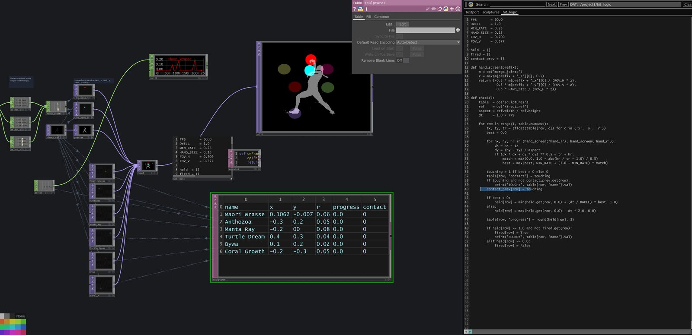

*The whole mechanic. Table DAT of sculptures with `progress` and `contact` columns, the script that writes them, and the comp it drives.*

I also added a `cell()` wrapper around every table read, because a blank cell in a half-filled row returns `None`, `float(None)` throws, and one bad row kills the callback for the entire frame. Returning a default is the difference between a wrong number and a dead interaction.

A TouchDesigner trap worth recording: the Execute DAT callback file must be at module level. A nested function inside `onFrameStart` silently kills every callback in that file rather than producing a visible error.

---

**11.10.2026**

## Water, and avoiding the cheap ripple

Looking at stylised water approaches rather than a plain ripple, which to my eye always reads as cheap. Derivative's **WaveTOP** is an implementation of the wave equation in TOPs alone, no custom GLSL, producing a heightmap that can displace a grid.

What I ended up liking more was **feedback and decay**, which creates a trail of motion rather than a wavefront. That fits the accumulation idea from the Blender tests better than a simulation does, and it is the only way a stateless system remembers anything.

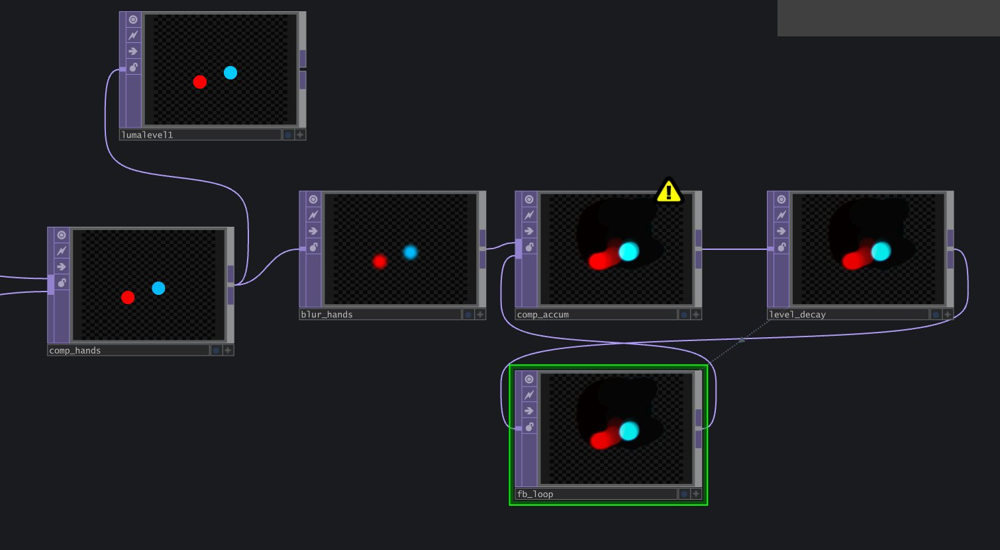

*Feedback and decay. Circles leave a trail that fades, which is what carves the water.*

This became the carved-water effect: circles leave a trail that fades, and the water reveals or covers the terrain beneath.

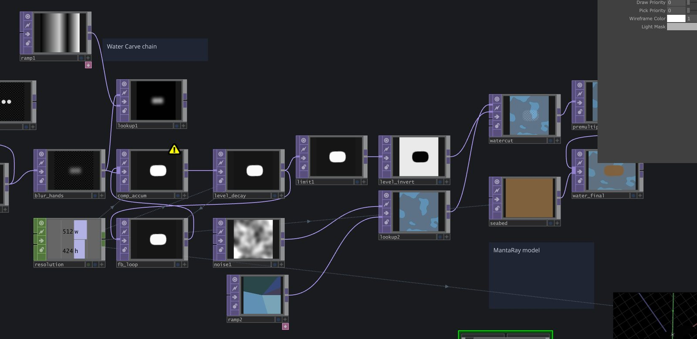

*The carve chain. Mask left, Reorder writing it into the water layer's alpha, Premultiply, then Over.*

Worth flagging for anyone else: a Feedback TOP needs an explicit Custom resolution. Leaving it on Use Input creates a circular dependency and you get a checkerboard rather than an error.

---

**14.10.2026**

## A manta ray that refused to be lit

Imported the manta ray FBX and it rendered pure black. Overrode the material, added a light, checked the normals in TouchDesigner, no change.

It was the mesh. Floating vertices and ngons. Cleaning the topology and recalculating outer normals in Blender fixed it immediately. The time went into assuming the problem was in the renderer when it was in the asset.

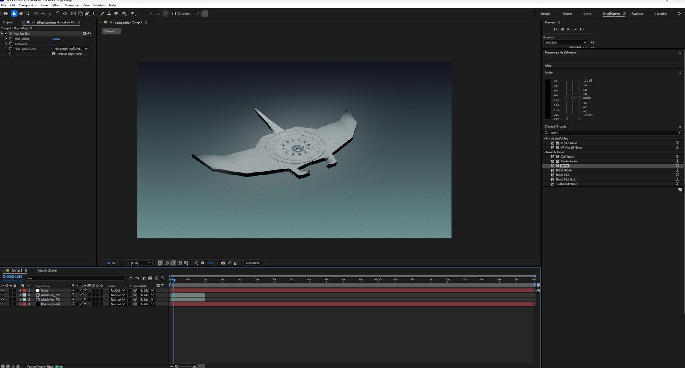

*Back in Blender to clean the topology. Normals recalculated and it lit correctly everywhere.*

Two TouchDesigner notes from the same session. FBX import wants **Y up, −Z forward**, and the material override lives on the **Advanced** tab, not where I first went looking.

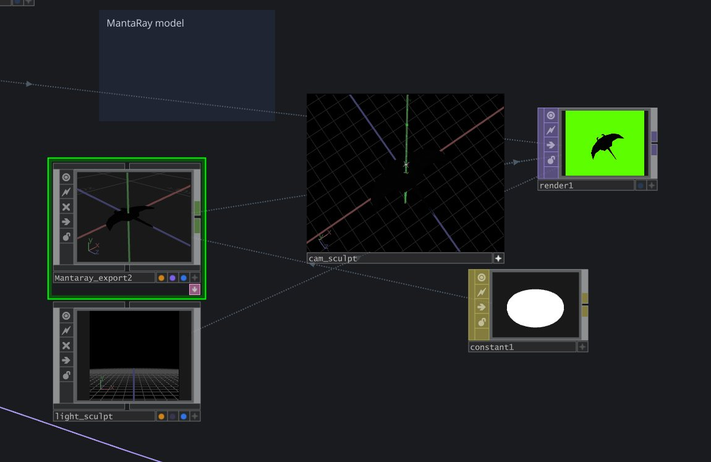

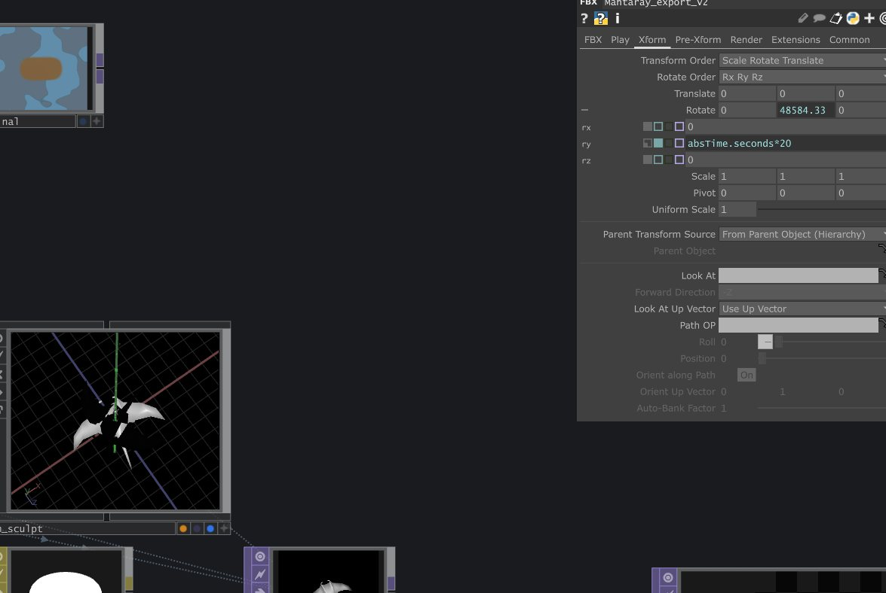

*Render chain, background alpha at zero so it composites. Right: `absTime.seconds * 20` on the rotation.*

A bob on Translate Y needs `math.sin()` rather than bare `sin()`, because parameter expressions do not have the bare maths functions in scope.

---

**19.10.2026**

## Exporting a picture of the data instead of the data

This is the mistake that cost me the most time, and the output looked completely fine.

I clipped the bathymetry to the Hook Island area in QGIS and exported it. The result came back with **four Byte bands**. I had exported the *Rendered* layer — the colour image QGIS draws on screen — rather than the raw values. Every depth reading had been pushed through a colour ramp into 0–255 RGB and the elevation data was gone. The file opened, it looked like a height map, and it was meaningless.

> Export the data, not a picture of the data.

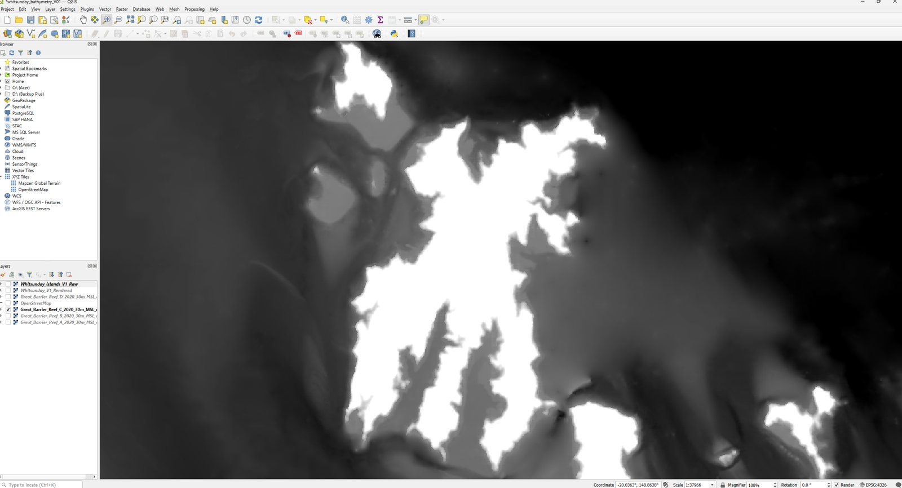

*The clip in QGIS. What you see is a rendering of the Float32 values, which is exactly the thing I then exported by mistake.*

Related: **Clip Raster by Extent** defaults NoData to 2.0, which quietly contaminates the range of anything you clip with it.

Doing it properly, straight from the QGIS Python console:

```
from osgeo import gdal
gdal.Translate(
    "seabed_8.png", "OUTPUT.tif",
    format="PNG", outputType=gdal.GDT_Byte,
    scaleParams=[[-78, 0, 0, 255]],
    width=1071, height=515)
```

And a second pass at the waterline to get a clean land mask:

```
gdal.Translate(
    "land_mask.png", "OUTPUT.tif",
    format="PNG", outputType=gdal.GDT_Byte,
    scaleParams=[[-0.01, 0.01, 0, 255]],
    width=1071, height=515)
```

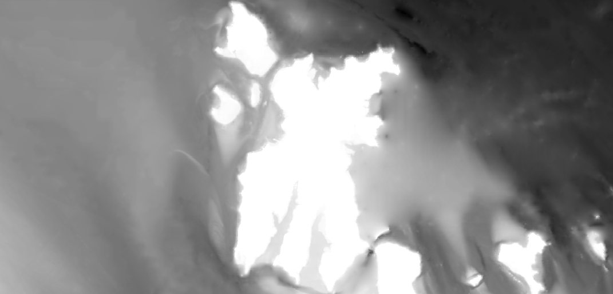

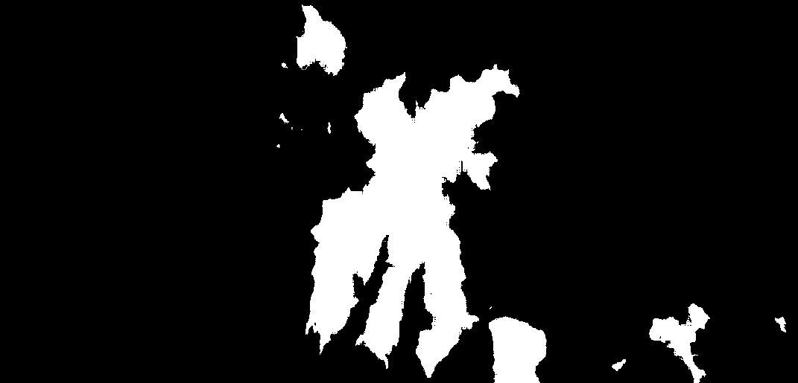

*The two exports. Seabed clamped to −78 m to 0, and a hard land mask from clipping a sliver either side of the waterline.*

The clamp to −78 to 0 is deliberate: it discards above-sea-level terrain so the 255 levels are spent on water depth rather than irrelevant land masses. The source is also corrected for aspect ratio so the output is not stretched by longitude compression.

One trap on the way in. `seabed_8.png` came into TouchDesigner and the Lookup produced no colour at all, just grey. I assumed it was a bit depth problem. It was not — the Movie File In's **Pixel Format** was on "Use Input", the PNG is single-channel greyscale, so **Mono** propagated down the whole chain. Mono has no colour channels and no alpha, so the Lookup had nowhere to write a colour. Setting the format explicitly to **8-bit RGBA** fixed it instantly. I had been reasoning about the data when the problem was in the container.

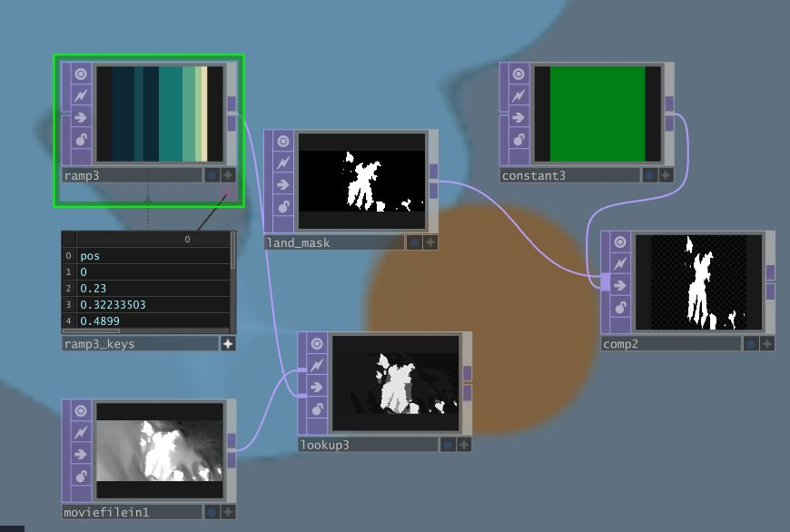

*Ramp into Lookup, land mask into the comp. Once the pixel format was right this took about ten minutes.*

---

**22.10.2026**

## The Kinect died, and the architecture held

The Kinect Fin supplied would not play with my laptop. Late in the piece, not enough time to troubleshoot it properly, and a genuine shame because the hardware is good and it is already in the Whitsundays.

Swapping to MediaPipe took an afternoon rather than a rebuild, and that is the part worth recording. The entire interaction runs off one constant at the top of the script:

```
SOURCE = 'mediapipe'     # 'kinect' or 'mediapipe'
```

Everything downstream — hit detection, the accumulator, the reveal, the comp — is written against normalised screen space. Only one function, `hand_screen()`, knows which sensor is running, and it returns the same three numbers either way: x, y, radius, in centre-space.

That was not foresight exactly. It fell out of the coordinate work two weeks earlier. Once I had been forced to be explicit about which space every number lived in, supporting a second source was a matter of writing one more conversion rather than changing anything that consumed it.

Worth connecting to the 2032 window. Any sensor I choose now is obsolete before the thing is installed. The part of this build with a six-year shelf life is not the Kinect and not MediaPipe, it is the boundary between them and everything else.

### Two things MediaPipe does not give you

**No spine, and no metric depth.** MediaPipe's 33 landmarks include a `z`, but it is relative to the hip midpoint and is not in metres, so it cannot drive the size-match mechanic the way the Kinect's `z` could.

The substitute is **shoulder span in image space**. Distance between the two shoulder landmarks: wide means close to the camera, narrow means far away. Not metric either, but monotonic and stable, which is all the mechanic actually needs. A `calib()` helper prints the right `HAND_FRAC` after standing at the distance I want to be the sweet spot.

**Already normalised.** MediaPipe reports 0–1 in image space, so there is no perspective divide at all on that path — just the 0.5 origin shift and the sign flips. Both axes came out inverted on the first run and both were a plain subtraction.

---

**23.10.2026**

## Inclusive design, written down properly

These decisions have been driving the build for a fortnight and have never made it into the journal, so here they are.

### Presence before reaching

Follows directly from what the skeleton actually is. It is a learned model, not geometry, and a learned model performs best on poses resembling its training data. Seated users, wheelchair users, people with restricted arm movement and people standing in a queue holding a bag all sit further from that training distribution, and they get worse tracking for reasons that have nothing to do with whether the sensor can see them.

So reaching with a hand cannot be the only way in. **Torso proximity triggers; reaching enhances.** Two routes to the same payoff, and the fallback is the more reliable of the two rather than a degraded version.

### Soft gating, not hard gating

`MIN_RATE` never reaching zero means nobody can do everything right and receive no response, with no way of knowing why. A hard distance gate would have been easier to implement and would silently exclude people.

### No faces, nothing stored

The system works from joint positions and shapes. It does not identify anyone, does not do face recognition, and retains nothing between frames except an accumulator that drains to zero. In a public terminal with a camera pointed at travellers, that is a position worth stating rather than leaving implicit.

This is also the cheaper option, which is usually how privacy decisions should be framed when you are arguing for them.

> **On SDGs.** Two are doing real work here rather than being listed. **SDG 14, Life Below Water** — the display surfaces reef restoration sites alongside the artworks, so the content is about reef recovery and not only about sculpture. **SDG 11, Sustainable Cities and Communities** — the accessibility decisions above are the evidence, in a piece of public infrastructure that people encounter whether or not they sought it out.

---

**24.10.2026**

## Presentation and demo

Built the explainer material for the team presentation: the slides for the technical section, a screen capture of the interaction running, and stills from the comp.

The demo was the strongest thing in the presentation, which is worth noting because it is the only part where the audience sees the thing work rather than being told about it. Everything else is renders and mock-ups.

> **[**Video slot**Screen capture of the working sculpture finder. Drop the MP4 in here as a `<video controls>` tag, or embed it from wherever it is hosted.]**

Reviewing the recording afterwards, two clear lessons for next time. I was 12 to 16 dB quieter than the other presenters, which is audible and costs the content credibility it had earned. And I talked continuously for seventy seconds over the demo, which is exactly the stretch where the audience is trying to watch something new and listen at the same time. Set it running, say one sentence, then be quiet for five seconds.

## Where it stands

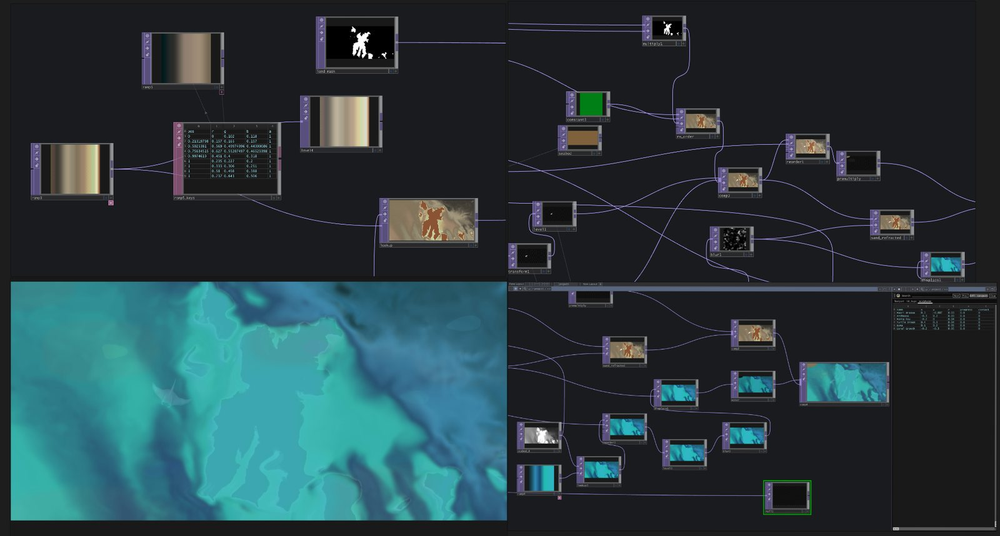

*The finished comp. Sand and depth-tinted water off the same raster, refraction from two offset noises, sculptures composited underneath.*

**Working:** joint tracking from either sensor, hand circles mapped correctly into screen space, dwell-based find with winner-takes-all targeting, water carve over a real bathymetric seabed, a water layer with noise-driven refraction, sculpture reveal with the manta ray model, labels on find.

**Known limitations, honestly:**

- **No community engagement beyond Council as client** and published material from Reef Ecologic and tourism operators. Real engagement would mean Reef Ecologic, airport operations, and travellers.
- **No Ngaro or Gia consultation.** This prototype uses Ngaro-named sculptures and Ngaro cultural context, built entirely from publicly available material. The task *"research local Ngaro/Gia opinions of the sculptures"* was written into our week five plan and was never completed by anyone, me included. Cultural approval is a gate before any public deployment, not a step we have taken.
- **Legacy undecided.** Does the display come out after the Games or stay? That one question answers the sustainability and maintenance ones at the same time — who powers it, who keeps the sculpture and restoration data current, and whether it is built for a fortnight or a decade.
- **No accessibility testing with actual seated users.** The reasoning above is sound but it is reasoning, not evidence.
- **Aspect ratio unresolved.** The map is 2.08:1 and the comp is 1.21:1, so the sculpture coordinates and the composition do not yet line up cleanly.
- **Visuals could be expanded.** The water is a displace driven by a noise normal, which worked well enough for the deliverable. A foam ring at the carve edge and a depth-tinted ramp were both scoped and neither was built.

Two things I would do differently. I would have put the inclusive design reasoning in writing weeks earlier, because it was driving decisions long before it was documented. And I would have tested the Kinect on my own machine in week five rather than week eleven.

The thing I will carry out of this is smaller and more useful than I expected. Most of the hard problems here were not interaction problems, they were problems of knowing which space a number was in. Metres or fractions, which origin, which direction, which axis. Once that was explicit, the sensor swap, the hit detection and the compositing all got easier, and the one afternoon where the hardware failed and the system did not care paid back every hour spent on it.

## References and sources

- Geoscience Australia. (2017). *AusBathyTopo (Great Barrier Reef) 30 m 2017 — a regional-scale depth model* (20170025C). [ecat.ga.gov.au](https://ecat.ga.gov.au/geonetwork/srv/api/records/0f4e635c-81ec-46d0-9c99-65e5fe0b8c01?language=eng)
- Shedroff, N. Interactivity in the context of designed experiences. *Journal of Interactive Advertising*. [tandfonline.com](https://www.tandfonline.com/doi/full/10.1080/15252019.2000.10722040)
- teamLab. *teamLab Planets*. [teamlab.art](https://www.teamlab.art/e/planets/)
- Universal Everything. [universaleverything.com](https://www.universaleverything.com/)
- INDE. *INDE's AR makes waiting for your baggage fun*.
- Torin Blankensmith — interactive and MediaPipe work.
- bileam tschepe (elekktronaut) and Josef Pelz — TouchDesigner technique.
- Reef Ecologic. *Whitsundays Reef Recovery and Public Art Project (WRAP)*. [reefecologic.org](https://reefecologic.org/project/wrap/)
- Sailing Whitsundays. *Ngaro Underwater Marine Sculpture Trail, Whitsundays*. [sailing-whitsundays.com](https://sailing-whitsundays.com/article/Ngaro-Underwater-Marine-Sculpture-Trail-Whitsundays)
- Australian Sailing. (2025). *Australian Sailing welcomes outcome of Brisbane Olympics 100 Day Review*. [sailing.org.au](https://www.sailing.org.au/news/australian-sailing-welcomes-outcome-of-100-day-review)
- ABC News. (2025, 25 March). *Brisbane 2032 Olympic Games venues*. [abc.net.au](https://www.abc.net.au/news/2025-03-25/brisbane-2032-olympic-games-venue-list/105090254)
- Derivative. *WaveTOP*. [derivative.ca](https://derivative.ca/community-post/asset/wavetop/67796)
- QGIS Project. *QGIS Desktop*. [qgis.org](https://qgis.org/download/)

## Use of AI

- **Learning.** Working out how Float32 rasters, pixel formats and time-of-flight sensing actually function. The pixel-as-container model and the four-coordinate-mismatch framing came out of those conversations and I have written both up in my own words here.
- **Debugging.** Diagnosing the perspective divide, the mirrored axis, the aspect-ratio mismatch and the Mono pixel format trap.
- **Previsualisation.** The lighting pass on the greybox terminal render.
- **Hit logic.** Claude 5.0 wrote the hit logic.
- **Converting this journal** from Markdown to HTML.

***Whitsunday in Motion** — BCI304, University of the Sunshine Coast, 2026. Interaction design, TouchDesigner build and technical documentation by Matt Bissell. Project team: Dylan Pollard, Thomas Grannes, Matthew Oliver, Alex Luc. Supervisor: Fin. Partner: Whitsunday Regional Council.*

*Bathymetry © Commonwealth of Australia (Geoscience Australia). Sculpture trail and restoration information courtesy of Reef Ecologic and Tourism Whitsundays.*
